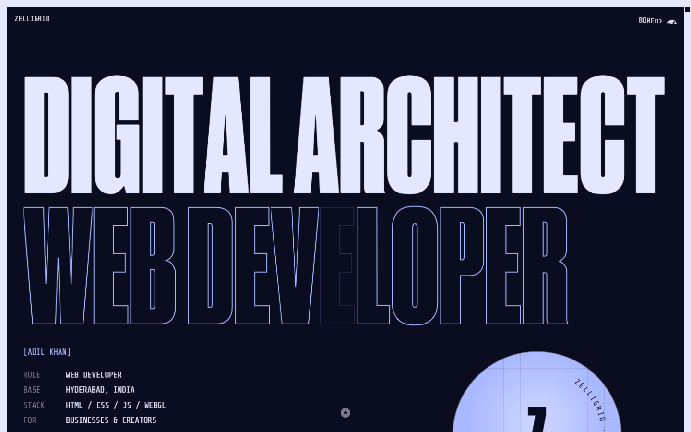

# ZELLIGRID — Adil Khan portfolio

A fully working, editable freelancing portfolio for **Adil Khan / ZELLIGRID**, built on the animated yeahright.co layout. The night palette, loader, cursor, scroll animations, WebGL screen effects and Pong easter egg are included.

- **Name:** Adil Khan
- **Brand:** ZELLIGRID
- **Role:** Web Developer / Digital Architect
- **Location:** Hyderabad, India
- **Email:** zelligrid1@gmail.com
- **Featured project:** Wolf MMA Fitness



## Run locally

```bash
npm start
```

Open **http://127.0.0.1:4173**.

No `npm install` is required. The preview uses a zero-dependency static server with video range support.

> Use the local server rather than double-clicking `index.html`. The site uses ES modules and absolute `/assets/...` paths, which browsers block on `file://`.

## Project structure

```text
.
├── index.html                  All page copy, links, metadata and project data
├── assets/
│   ├── css/style.css           Layout, type, colours and ZELLIGRID additions
│   ├── js/main.js              Loader, cursor, audio, gallery, Pong, GSAP
│   ├── js/index.BzC_51kD.js    Three.js / WebGL screen effects (lazy-loaded)
│   ├── branding/               Favicon, app icons, OG card, web manifest
│   ├── fonts/                  Self-hosted fonts
│   ├── media/                  Cursor image and interface sounds
│   └── work/
│       ├── wolf-mma.jpg        Project poster
│       └── wolf-mma.mp4        Project preview video
├── server.mjs                  Local preview server
├── netlify.toml                Ready-to-use Netlify settings
├── package.json
└── README.md
```

## What to edit

| Change | Where |
| --- | --- |
| Browser title, description, social metadata | `index.html`, top `<head>` |
| Hero words, about copy, footer copy | `index.html` |
| Email address and contact links | `index.html` + `assets/js/main.js` (`const fa = ...`) |
| Instagram / LinkedIn / GitHub | `index.html`, search for `link coming soon` |
| Project title, caption, link, poster | `index.html`, `data-channels` on `<section class="work">` |
| Project video | `assets/work/wolf-mma.mp4` |
| Project poster | `assets/work/wolf-mma.jpg` |
| Colours | `assets/css/style.css`, `:root` around line **3739** |
| Loader labels | `assets/js/main.js`, `Sn = [...]` |
| Favicon / social card | `assets/branding/` |

### Social links

The Instagram, LinkedIn and GitHub entries are deliberately non-clickable placeholders marked **[soon]**. When you have the URLs:

1. Find `link coming soon` in `index.html`.
2. Replace the `<span class="footer__link footer__link--pending" ...>` with:

```html
<a class="footer__link" href="https://instagram.com/YOUR-HANDLE" target="_blank" rel="noopener noreferrer">
  <!-- keep the existing inner spans -->
</a>
```

3. Change the visible `[soon]` label back to just the network name.
4. Remove `footer__link--pending` and the `aria-disabled` attribute.

### Adding another project

The current gallery is set to one project (`work--single`).

1. Add another object to the `data-channels` JSON in `index.html`:
   ```json
   {
     "title": "Project name",
     "url": "https://example.com",
     "caption": "One sentence about the project.",
     "poster": "/assets/work/example.jpg"
   }
   ```
2. Add a matching video element next to the existing one:
   ```html
   <video class="work__video" data-channel-video preload="none" muted loop playsinline aria-hidden="true">
     <source src="/assets/work/example.mp4" type="video/mp4" />
   </video>
   ```
3. Remove `work--single` from the `<section class="work ...">` element to show the channel controls.
4. Add the poster and video files, then test the arrows, number keys and swipe.

If you do not have a video, a still poster works, but the TV screen effect expects a video for each channel. Ask for a still-image gallery if that is easier.

### Animated headings

Large headings are split into one `<span>` per character for the letter animation:

```html
<span class="char--letter" style="--char-delay:0s"><span>C</span></span>
```

When changing them, update the visible characters and the matching `sr-only` label. If the length changes a lot, keep the words/lines balanced so the responsive fit still looks right. The hero title automatically scales to the viewport, so replacing it with a much longer phrase can make the outline line overflow.

## Publish to GitHub

The folder is already initialised as a Git repository with an initial commit.

1. Create an empty repository on GitHub, for example **`portfolio`**. Do not add a README there.
2. In PowerShell:

```powershell
cd C:\Users\Admin\Desktop\zelligrid
git remote add origin https://github.com/YOUR-USERNAME/portfolio.git
git branch -M main
git push -u origin main
```

GitHub will open a browser sign-in the first time. Passwords are not accepted for Git pushes; use the browser sign-in or a Personal Access Token.

If you change files later:

```powershell
git add .
git commit -m "Update portfolio"
git push
```

## Publish the website

### Netlify — recommended

1. Sign in at [netlify.com](https://www.netlify.com) with GitHub.
2. **Add new site → Import an existing project → GitHub**.
3. Select the repository.
4. Build command: **empty**. Publish directory: **`.`**
5. Deploy.

`netlify.toml` already contains these settings. You get a free `something.netlify.app` URL and automatic HTTPS.

To use a custom domain:

1. Buy a domain (Cloudflare Registrar, Namecheap, Porkbun, etc.).
2. Netlify → **Domain management → Add a domain**.
3. Follow the DNS instructions; HTTPS is issued automatically.

### Vercel / Cloudflare Pages

Use the same idea: import the Git repository, choose “Other” or “Static”, leave the build command empty, and set the output directory to `.`.

### GitHub Pages

GitHub Pages can host this, but the site uses root-absolute paths (`/assets/...`). It works at a custom domain root, not at `username.github.io/portfolio/`, unless the paths are changed to relative paths or a custom domain is configured. Netlify avoids this issue.

## Before you launch

- [ ] Add your real Instagram / LinkedIn / GitHub URLs, or keep `[soon]`.
- [ ] Confirm you have permission to publish the **Wolf MMA Fitness** screenshot and name as client work.
- [ ] Replace the bio if you want different wording.
- [ ] Add a canonical URL and `og:url` to `index.html` once the domain is live.
- [ ] Change `og:image` to an absolute URL after choosing the domain.
- [ ] Test the email copy button, project link, mobile menu-free layout and loader.
- [ ] Update `preview.png` after final copy changes.

## Credits and rights

The starting layout was cloned from **yeahright.co** and then rebranded. The ZELLIGRID name, copy and contact details are Adil Khan’s. The original design, code structure and animation work remain attributable to their original creator; confirm you have the right to publish a derivative of that design before commercial use. Wolf MMA Fitness content belongs to its owner. GSAP and Three.js retain their respective licences.
